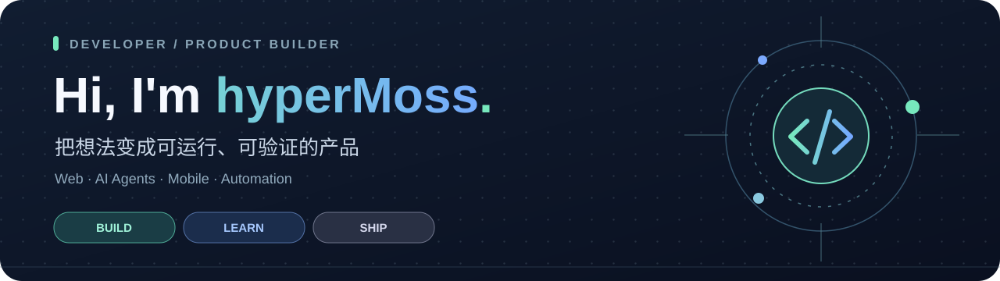
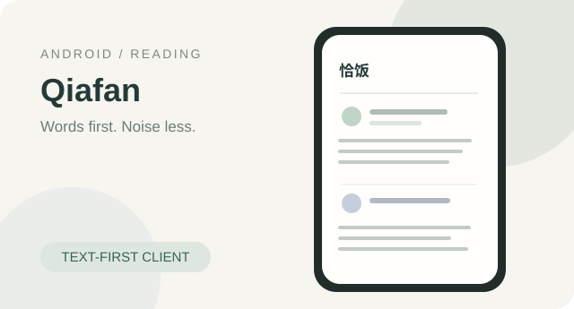
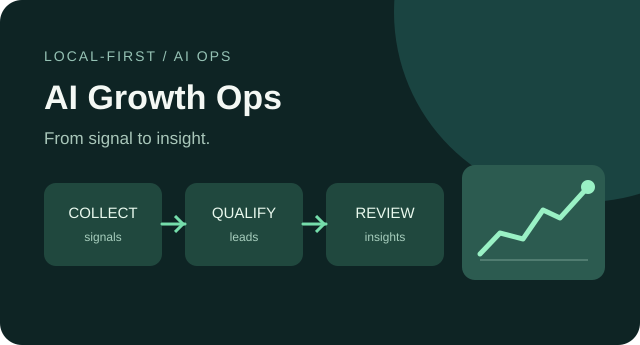
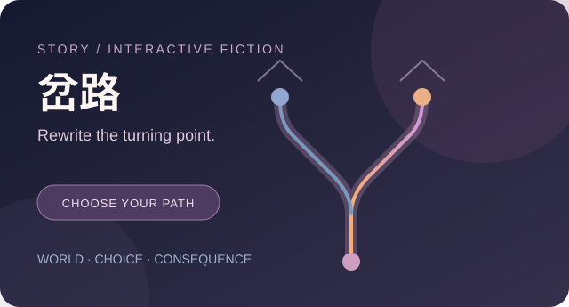
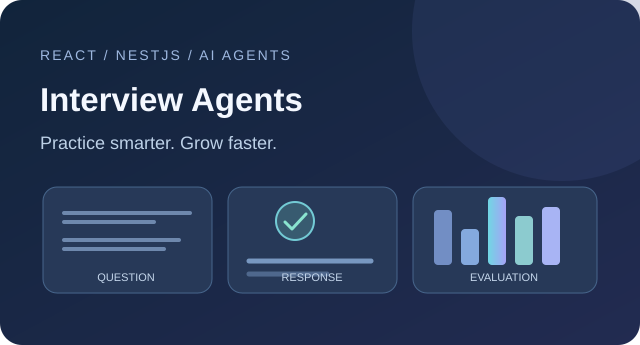

 

**你好，我是 hyperMoss。** 喜欢用代码解决具体问题，也喜欢把零散的想法打磨成可用的产品。

[**精选项目**](#-精选项目) &nbsp;·&nbsp; [**工具与实验**](#-工具与实验) &nbsp;·&nbsp; [**技术栈**](#-技术栈) &nbsp;·&nbsp; [**GitHub 活动**](#-github-活动)

---

## ✨ 精选项目

近期重点投入的四个项目，涵盖 Android 客户端、AI 获客、互动剧情与模拟面试。项目介绍依据各仓库当前 README 整理。

<table>
  <tr>
    <td width="50%" valign="top">
      
      <h3><a href="https://github.com/hyperMoss/qiafan">恰饭 · Qiafan ↗</a></h3>
      
文字优先的饭否 Android 客户端，支持关注信息流、通知、搜索、动态详情及互动。保留 Kuikly 多平台工程，当前以 Android 体验为主。

      
<code>Kotlin</code> <code>Android</code> <code>Kuikly</code>

    </td>
    <td width="50%" valign="top">
      
      <h3><a href="https://github.com/hyperMoss/geiwokehu">AI Growth Ops · geiwokehu ↗</a></h3>
      
本地运行的获客工作台。围绕抖音、小红书关键词素材与评论，实现潜客初筛、人工复核、客户管理、获客看板和手动触发的 AI 分析。

      
<code>Next.js</code> <code>Python</code> <code>SQLite</code>

    </td>
  </tr>
  <tr>
    <td width="50%" valign="top">
      
      <h3><a href="https://github.com/hyperMoss/story">岔路 · Story ↗</a></h3>
      
面向故事作者的动态剧情推演 MVP。导入故事、编辑世界卡，从关键分歧点作出选择，持续推演剧情、修正草案并回顾不同路线。

      
<code>Next.js</code> <code>TypeScript</code> <code>AI</code>

    </td>
    <td width="50%" valign="top">
      
      <h3><a href="https://github.com/hyperMoss/interview-agents">面试练习室 · Interview Agents ↗</a></h3>
      
中文 AI 模拟面试应用：根据简历与目标岗位规划题目，支持题库、联网搜索、动态重规划、逐题反馈、能力评估与复盘报告。

      
<code>React</code> <code>NestJS</code> <code>Hono / Mastra</code>

    </td>
  </tr>
</table>

封面为主页专用概念插画，并非应用运行截图。功能范围、部署方式与验证状态请以对应项目 README 为准。

## 🧰 工具与实验

一些为解决具体问题而做的小工具，也包括持续学习过程中的探索。

| 项目 | 简介 | 方向 |
| :--- | :--- | :--- |
| [**dsh-diary**](https://github.com/hyperMoss/dsh-diary) | DeepSeek Harness 的 Markdown 日记、全文搜索与模板管理插件 | AI / Plugin |
| [**FLIGHT-TRACKER**](https://github.com/hyperMoss/FLIGHT-TRACKER) | 监控航线价格、筛选低价航班并推送飞书 | Python / Automation |
| [**life-elephant**](https://github.com/hyperMoss/life-elephant) | 公司人数变化记录与趋势统计小程序 | Taro / Vue 3 |
| [**vitepress-auto-config**](https://github.com/hyperMoss/vitepress-auto-config) | 按文件目录和 Markdown 标题生成 VitePress 导航的思路与示例 | JavaScript / Docs |
| [**Swaggerjson-MockServer**](https://github.com/hyperMoss/Swaggerjson-MockServer) | 基于 Swagger 导出 JSON 的本地 Mock 服务 | Frontend / Tooling |
| [**echarts-demo**](https://github.com/hyperMoss/echarts-demo) | 数据可视化与图表实践 | ECharts |

## 🧑‍💻 技术栈

**日常关注**：Web 应用、跨端开发、AI Agent、自动化、工具链与工程实践。

技术图标代表在项目和学习中涉及的工具，不代表熟练度排名。

## 📈 GitHub 活动

统计卡片依赖第三方动态图片服务，可能偶尔限流或加载失败；语言占比仅反映仓库代码统计，不代表技术能力。

---

**Keep learning. Keep building. Keep shipping.**

[查看全部仓库](https://github.com/hyperMoss?tab=repositories) · [博客仓库](https://github.com/hyperMoss/hyperMoss.github.io)

